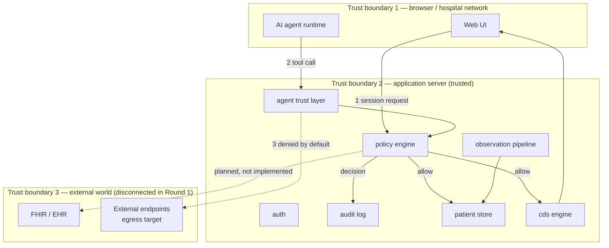

# Data Flow and Trust Boundaries — MedIntel Nexus

**Status:** Design document for Round 1 · v0.9 · 2026-10-27

---

## 1. Trust boundaries

| # | Boundary | What crosses it | Controls |
|---|---|---|---|
| B1→B2 | Client → application server | Session tokens, requests, agent tool calls, observations | TLS (in deployment), authentication, per-request policy check, input validation |
| Inside B2 | Between modules | Internal calls | Narrow interfaces; only `policy` decides access, only `audit` writes decisions |
| B2→B3 | Application → external systems | Nothing in Round 1 | Egress is a distinct permission class; default deny; adapter planned only |

## 2. Data flows

### DF-1 — Clinical read (doctor opens a patient)
`UI → API → policy(allow) → audit(allow) → patient store → UI`
Recorded: principal, `patient.read`, patient ID, timestamp, reason.

### DF-2 — Nurse observation write
`UI → API → policy(nurse assigned?) → validation → store → audit`
Denied when the patient is not assigned → `403` + `audit(deny)`.

### DF-3 — Observation ingestion (simulated device)
`stream → schema/unit/freshness/plausibility/correlation checks → persist(verdict) → notify authorized viewers`
Never skips the validation stage; every verdict is persisted with the observation.

### DF-4 — Clinical decision support request
`UI → API → policy(clinical read) → cds.generate → suggestions with evidence → UI`
State starts at `suggested`; only a human clinical principal may transition it.

### DF-5 — AI agent read (allowed)
`agent → agent trust layer → policy(agent scope + patient grant) → audit(allow) → scoped response`
Response is limited to the granted record types — no "whole chart" default.

### DF-6 — AI agent exfiltration attempt (blocked)
`agent → agent trust layer → egress permission missing → audit(deny) → 403`
No data leaves the process; the denial itself is the evidence artifact.

### DF-7 — Amendment, not overwrite
`UI → API → policy(write) → append amendment event with author + timestamp → new version`
Prior versions remain readable; nothing is mutated in place.

## 3. What is *not* flowing (Round 1)

- No outbound internet traffic from the application.
- No real PHI: all records are synthetic and labelled.
- No third-party analytics, fonts, or CDN dependencies in the demo UI.

## 4. Boundary weaknesses (stated, not hidden)

1. Session tokens in the prototype are demo-grade (no TLS on localhost, no rotation
   policy) — production requires an established auth provider.
2. The append-only guarantee of the audit log is enforced in application code, not by a
   WORM store or database trigger; a host-level attacker could modify it. Documented in
   `docs/security/AUTHORIZATION_AND_AUDIT.md`.
3. Agent tool *output* filtering (redaction before leaving the boundary) is designed but
   not implemented.

See `docs/security/THREAT_MODEL.md` for the full actor analysis.
