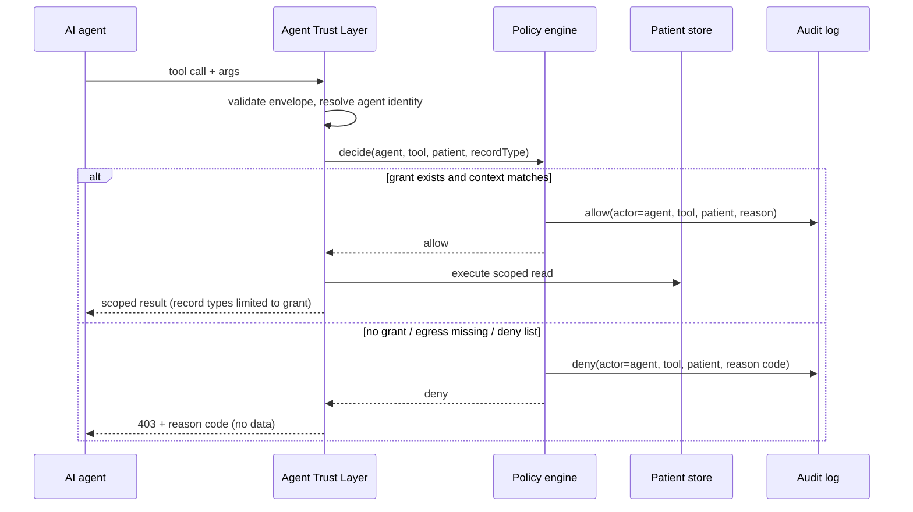

# Agent Trust Layer (Agent Firewall) — MedIntel Nexus

**Status:** Design document + implemented prototype enforcement · v0.9 · 2026-10-27

> The Agent Trust Layer is a **concept and a prototype control**, not a shipped product.
> Nothing here claims third-party adoption, deployment, or independent security
> certification.

---

## 1. Purpose

Give AI agents access to hospital data **without trusting them**. Every tool call an agent
makes is evaluated at a server-side enforcement boundary against an explicit, written-down
policy. The agent cannot widen its own permissions, and every decision is audited.

## 2. Core rules

1. **Deny by default.** A tool not named in the policy is refused.
2. **Grants are data, not prompts.** Permissions live in the policy store; nothing an
   agent says — in a prompt, a tool argument, or retrieved patient text — can create or
   modify a grant.
3. **Same engine as humans.** Agent calls pass through the identical `policy.decide()`
   used for doctor/nurse requests, plus agent-specific rules. There is no second,
   softer path.
4. **Egress is separate.** Reading is not exporting. `egress.export` must be granted
   explicitly, per destination class.
5. **Humans-only actions are closed to agents.** `cds.decide` (recording a clinical
   decision) and `admin.*` are unconditionally denied for agents.
6. **Every decision is an audit event** — allows as well as denies.

## 3. Policy model

```json
{
  "agentId": "SYN-AGENT-01",
  "purpose": "ward summary assistant",
  "grants": [
    { "tool": "patient.timeline.read", "patients": ["SYN-P-0042"], "recordTypes": ["timeline", "observation"] },
    { "tool": "cds.request", "patients": ["SYN-P-0042"] }
  ],
  "deny": ["cds.decide", "admin.users", "admin.assignments"],
  "egress": { "allowed": [], "default": "deny" },
  "validFrom": "2026-10-27T00:00:00Z",
  "validTo": "2026-11-27T00:00:00Z"
}
```

Evaluation order: `deny` list → grant lookup (tool, patient, record type) → validity
window → context checks → **allow**, else **deny with reason code**.

## 4. Enforcement sequence



## 5. Implemented scenarios (prototype)

| # | Scenario | Expected | Test |
|---|---|---|---|
| 1 | Agent with grant reads assigned patient timeline | Allowed, audited | AT-13 |
| 2 | Agent reads a patient outside its grant | Denied, audited with reason | AT-14 |
| 3 | Agent attempts outbound export without `egress.export` | Denied, audited | AT-17 |
| 4 | Agent attempts `cds.decide` | Denied unconditionally | AT-13 |

Live walkthrough: `docs/DEMO_SCENARIOS.md` (scenario B).

## 6. Why an enforcement *boundary* rather than prompt instructions

Telling an agent "do not access other patients" is a request, not a control: an
instruction in a prompt can be overridden by an instruction in retrieved content
(indirect prompt injection). Moving the decision to a server-side check makes the outcome
independent of anything written in text — the agent's intent is irrelevant, only its
grant matters.

## 7. Limitations (explicit)

- Policy granularity is per tool/patient/record type; no purpose-limitation enforcement
  (a granted read cannot be verified as being for the stated purpose).
- No output redaction or size limiting yet — an agent can receive the full granted record.
- No key rotation or hardware attestation for agents; demo identity is a static ID.
- No abuse-rate detection: an agent within its grant could still enumerate aggressively.
- Not audited by a third party; not tested against a real adversarial agent.
