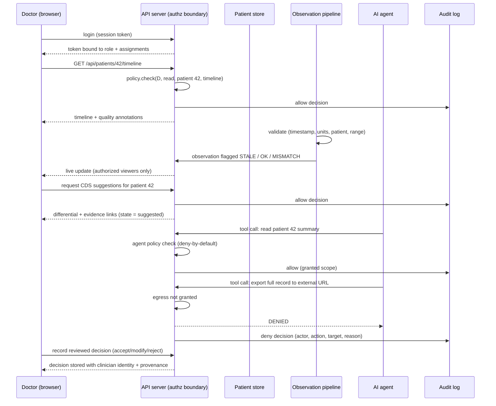

# MedIntel Nexus — Round 1 Proposal

**Virtusa Jatayu Season 6 · Healthcare & Life Sciences**
**Document status:** DRAFT — final-for-review, pending official Round 1 brief
**Version:** 0.9 · 2026-10-27

> **Title:** MedIntel Nexus: Secure, Connected Patient Intelligence and
> Clinician-Supervised Decision Support
>
> **One-line pitch:** One screen where a clinician sees a patient's full timeline and
> quality-flagged vitals, with every AI suggestion reviewed by a human and every AI-agent
> action blocked unless the server explicitly allows it.

> ⚠️ **Challenge framing note.** The official Season 6 HLS challenge statements could not
> be retrieved (see `docs/competition/ROUND_1_REQUIREMENTS_REGISTER.md`, item R-19). The
> "Selected official challenge" section below is a *provisional* team problem statement and
> must be replaced with the official challenge ID and wording before submission.

---

## 1. Selected challenge and reference

| Field | Value |
|---|---|
| Domain | Healthcare & Life Sciences (HLS) |
| Selected challenge | Provisional: *clinician-supervised hospital intelligence* — see `docs/strategy/SELECTED_CHALLENGE_AND_RATIONALE.md` |
| Official challenge ID / wording | **Unknown — pending official packet (R-19)** |
| Comparison of alternatives | `docs/strategy/HLS_CHALLENGE_COMPARISON.md` |

## 2. Problem statement

Ward clinicians make time-pressured decisions from fragmented inputs: a patient's history
is scattered across admissions, notes, and monitoring feeds that arrive with no freshness
or quality context. Meanwhile hospitals are adopting AI tools that read patient data and
call external services with no per-patient permission model and no reliable audit trail.

The result is a double gap:

1. **Clinical gap** — the reviewing doctor or nurse reconstructs the picture manually,
   and cannot easily tell whether the vitals on screen are current, plausible, or even
   attached to the right patient.
2. **Trust gap** — if an AI agent is introduced into that workflow, nothing structurally
   prevents it from reading a patient it was not granted, or exfiltrating data outbound,
   and nothing proves afterwards what it did.

## 3. Target users

| User | What they need |
|---|---|
| Ward doctor / consultant | Longitudinal timeline, quality-flagged vitals, and *suggested* differentials they must verify |
| Nurse | Bedside observations, task execution, attributable actions |
| Hospital IT / security / compliance | Server-enforced permissions, agent allow/deny policy, immutable audit |
| Patient (indirect) | Their data is read only by authorised people, for authorised reasons |

Non-users for Round 1: patients themselves (no patient-facing app), radiologists, payers.

## 4. How the problem is addressed today

- Paper or EHR chart review, with the clinician mentally merging multiple screens.
- Monitoring systems that alarm on thresholds but do not annotate data quality or patient
  association ambiguity.
- AI assistants (general LLM chat) used informally, outside hospital permission models,
  with prompts and outputs rarely logged.
- Access control expressed as broad roles ("doctor can see the ward") enforced partly in
  the UI rather than on every server operation.

## 5. Why current approaches are insufficient

| Today | Insufficient because |
|---|---|
| Broad ward-level roles | Do not answer "may *this* user read *this* patient's *this* record type right now" |
| UI-level restrictions | Bypassable by any direct API call; not an enforcement boundary |
| Unlogged AI assistants | No evidence of what data an agent touched; nothing to show a regulator or internal review |
| Raw vitals on dashboards | Stale, implausible, or mismatched measurements can look identical to valid ones |
| Silent record edits | Destroy provenance; clinical notes must be amended, not overwritten |

## 6. Proposed solution

**MedIntel Nexus** is a modular hospital-intelligence application with three cooperating
layers:

1. **Clinical layer** — synthetic-but-realistic patient records, a longitudinal timeline,
   a doctor view and a nurse view, and patient-specific assignments.
2. **Observation layer** — a validated ingestion pipeline for (simulated) vital-sign
   streams. Every observation carries source, device, timestamp, units, freshness and a
   quality verdict; bad data is flagged, never silently trusted.
3. **Trust layer (Agent Trust Layer / Agent Firewall)** — every operation, human *or* AI,
   is authorized server-side against `(role, patient assignment, department, record type,
   requested action)`. AI agents additionally run under a deny-by-default tool policy
   with an explicit egress control, and every decision — allow or deny — is written to an
   append-only audit log.

On top sits **clinician-supervised decision support**: the system proposes a *differential
with evidence and citations to the timeline entries it used*; a clinician must review and
record a decision. There is no code path that accepts a suggestion automatically.

## 7. Innovation and differentiation

1. **One enforcement boundary for humans and agents.** Most products bolt an "AI
   permissions" screen onto an existing app. Here the same policy engine decides for both,
   so a gap in the agent policy cannot be wider than a gap in the human policy.
2. **Patient-specific authorization, not just role-based.** Permission =
   `f(role, assignment, department, record type, action)`, evaluated on every request.
3. **Data quality as a first-class clinical signal.** Freshness, plausibility and patient
   association are surfaced next to the value, with `STALE`, `IMPLAUSIBLE` and
   `PATIENT_MISMATCH` states that block silent use.
4. **Provenance-preserving records.** Amendments append; history is never rewritten.
5. **Evidence-driven, not claim-driven.** Every capability is either *implemented and
   tested* (see `docs/validation/ROUND_1_ACCEPTANCE_TESTS.md`), *simulated*, *designed*
   or *planned* — and is labelled as exactly one of those.

## 8. End-to-end workflow



## 9. Architecture summary

Modular monolith (single deployable, internally separated modules) — chosen deliberately
over microservices because Round 1 has no scale evidence justifying distributed systems.

```
[ Browser UI: doctor / nurse / admin ]
        │  HTTPS + session token
        ▼
[ API layer — authentication, policy engine, audit writer ]   ← single enforcement boundary
   │            │                │                 │
   ▼            ▼                ▼                 ▼
[ Patient   [ Observation   [ CDS engine      [ Agent Trust
  store ]    ingestion ]     (suggestions) ]    Layer (tool
  PostgreSQL  validation     no auto-accept     policy, egress
  or SQLite   pipeline       ]                 control) ]
                                                        
        cross-cutting: audit log (append-only), synthetic-data labelling
```

Full detail: `docs/architecture/SYSTEM_ARCHITECTURE.md`.

## 10. Data: what enters, where it flows, where it is stored

| Data | Enters via | Flow | Storage |
|---|---|---|---|
| Patient demographics, encounters, notes | Seeded synthetic dataset | Ingest → store → timeline API | Relational DB (PostgreSQL in production, SQLite in the prototype) |
| Vital signs | Simulated stream (device adapter in production) | Validate → flag → persist observation → push to authorized viewers | DB (time-series table/partition) |
| User accounts & assignments | Admin provisioning | Auth service → policy context | DB (hashed credentials only) |
| AI-agent tool calls | Agent runtime | Policy check → execute or deny → audit | Audit log (append-only) |
| Clinical decisions | Clinician UI | State machine `suggested → reviewed` | DB, with clinician identity + timestamp |
| Audit events | Written by the API/policy engine | Never mutated after write | Append-only table |

Nothing real is stored: all demonstration data is synthetic and labelled.

## 11. Identity, data quality, access control, privacy, security

- **Identity:** session-based authentication; every request carries an authenticated
  principal with role and patient assignments.
- **Authorization:** server-side on every protected operation; UI hiding is treated as
  convenience, never as control. See `docs/security/AUTHORIZATION_AND_AUDIT.md`.
- **Patient isolation:** cross-patient access is denied by default and tested (AT-03).
- **Administration ≠ clinical access:** an admin's account-management privilege does not
  grant clinical read (AT-06).
- **Data quality:** ingestion gate flags stale / implausible / mismatched observations;
  flagged values are visible but marked untrustworthy (AT-08…AT-10).
- **Privacy:** minimum-necessary access, synthetic data only, no secrets in the repo,
  retention and deletion policy described in `docs/security/PRIVACY_AND_DATA_GOVERNANCE.md`.
- **Security:** threat model, secrets handling, incident response in
  `docs/security/THREAT_MODEL.md`.

## 12. What the doctor sees

A single patient workspace: identity banner (with synthetic-data marker), the
longitudinal timeline, a vitals panel where each value shows its timestamp, source device
and quality badge, a "request suggestions" action returning a differential with the
evidence entries used, and a mandatory review control (`accept with modifications` /
`reject` / `defer`) with a comment. Nothing is pre-accepted.

## 13. What the nurse sees

The assigned-patient list, bedside observations for those patients (with the same quality
badges), care tasks attributable to the nurse, and read-only access to the clinical
timeline unless a write permission is explicitly granted. Every nurse action is recorded
in the audit log under their identity (AT-04).

## 14. How recommendations are reviewed and approved

State machine: `suggested → (clinician) reviewed → accepted | accepted_with_modifications | rejected | deferred`.
Only an authenticated human principal with clinical privileges on that patient can
transition state; agents cannot. The stored decision keeps the clinician's identity,
timestamp, and free-text rationale.

## 15. Handling bad sensor data

| Condition | Detection | Behaviour |
|---|---|---|
| Stale (older than freshness window) | `now - observed_at > threshold` | Flag `STALE`; shown greyed with age; excluded from "current" display |
| Missing | No observation in the window | Explicit "no data" state — never a blank chart implying normal |
| Implausible | Outside physiologic bounds for the vital | Flag `IMPLAUSIBLE`; requires human confirmation |
| Wrong patient | Ingestion correlation ID does not match patient | Flag `PATIENT_MISMATCH`; quarantined, not shown as that patient's data |
| Unit mismatch | Unit not in the accepted set for the vital | Rejected at ingestion with a logged error |

Thresholds used in the prototype are **illustrative defaults**, not clinically approved
limits (`docs/clinical/SENSOR_DATA_QUALITY.md`).

## 16. Preventing and auditing unauthorized reads, writes and transfers

- **Reads / writes:** the policy engine runs before any store access; deny by default.
  Every allow and deny is logged with actor, action, target, decision and reason (AT-15).
- **Outbound transfer:** egress is a distinct permission class. An agent holding read
  permission does **not** impliedly hold egress; the export scenario in AT-17 demonstrates
  a deny.
- **Integrity:** audit rows are append-only; the prototype rejects updates/deletes to the
  audit store in code paths (design-level guarantee, documented as such in
  `docs/security/AUTHORIZATION_AND_AUDIT.md`).
- **Prompt injection:** agent inputs are treated as untrusted; instructions cannot grant
  permissions — only the server-side policy can (documented in `docs/security/THREAT_MODEL.md`).

## 17. Evidence available in Round 1 (verified facts only)

| Evidence | Type | Status |
|---|---|---|
| Working prototype: authz, timeline, quality flags, CDS review flow, agent enforcement, audit log | Implemented | Built in `prototype/` |
| Automated acceptance tests AT-01…AT-18 (+ sub-checks) | Implemented | Run with `npm test` (`node --test "test/*.test.js"`); 25/25 passed — results recorded in `docs/validation/ROUND_1_ACCEPTANCE_TESTS.md` |
| Architecture / threat model / clinical-safety documents | Documents | Produced in `docs/` |
| Real hospital integration | — | **Not claimed — does not exist** |
| Model performance metrics | — | **Not claimed — no model is trained or evaluated** |
| Clinical validation | — | **Not claimed — synthetic demonstration only** |

## 18. Expected impact and how it will be measured

Impact claims are **targets to be measured in a pilot**, not results.

| Target (to measure, not achieved) | Metric | How measured |
|---|---|---|
| Faster chart review | Time from patient open to "review complete" | Instrumented workflow timing in pilot |
| Fewer unreviewed AI suggestions | % of suggestions with a recorded clinician decision | Audit/CDS tables |
| Fewer silent bad-data readings | # of `STALE/IMPLAUSIBLE/MISMATCH` flags acted upon vs. missed | Quality-flag analytics |
| Complete accountability | % of privileged operations with a complete audit record | Audit coverage report |
| Blocked unauthorised agent actions | # of denies with reason codes | Agent policy log |

Definitions and formulas: `docs/validation/IMPACT_METRICS.md`.

## 19. Prototype / demo plan

Two scripted scenarios, runnable in under 10 minutes on a laptop with Node.js only
(`docs/DEMO_GUIDE.md`, `docs/DEMO_SCENARIOS.md`):

1. **Clinical path:** doctor logs in → timeline → vitals with a stale and an implausible
   value → request suggestions → review and record a decision → audit entries visible.
2. **Trust path:** agent attempts an authorised read (allowed), then an unauthorised
   cross-patient read and an outbound export (both denied) → audit shows all three with
   reasons; a nurse's out-of-scope write attempt is also denied.

## 20. Risks and mitigations

| Risk | Likelihood | Impact | Mitigation |
|---|---|---|---|
| Official challenge differs materially from our framing | Medium | High | Register kept provisional; re-map before submitting (R-19) |
| Reviewers interpret synthetic demo as a real deployment | Medium | High | Disclaimers in every demo surface and document |
| Permission model incomplete (emergencies, delegations) | Medium | Medium | Break-glass design documented, explicitly unimplemented |
| Over-broad scope for Round 1 | Medium | Medium | Scope frozen in `SELECTED_CHALLENGE_AND_RATIONALE.md` §4 |
| Team details missing | High (currently true) | Medium | `submission/TEAM_INFORMATION_REQUIRED.md` checklist |
| Binary formats (PDF/PPTX) required but no toolchain | Medium | Medium | Markdown sources ready; conversion flagged as open item |

## 21. Costs, dependencies, limitations

- **Costs:** zero infrastructure cost for Round 1 (local Node.js runtime, no paid
  services, no API keys required to run the demo).
- **Dependencies:** Node.js ≥ 18 for the prototype; an official challenge packet and team
  details from the team; later, a PostgreSQL instance and an institutional review pathway.
- **Limitations:** no real clinical data, no real devices, no trained model, no clinical
  validation, no regulatory clearance — all stated plainly in
  `docs/validation/KNOWN_LIMITATIONS.md`.

## 22. Roadmap

| Phase | Contents | Status label |
|---|---|---|
| Round 1 (now) | Documents + scoped prototype with tests | In progress |
| Stage 2 (if qualified) | Fidelity: real auth provider, FHIR read adapter, break-glass, UI polish | Planned |
| Stage 3 / industrialization | Device adapters, pilot with a partner unit, validation study | Planned |
| Longer term | Regulatory pathway assessment, multi-site scaling | Future |

## 23. Responsible-AI and clinical-safety statement

Clinical decision support **assists** clinicians; it does not replace them. Differentials
are suggestions requiring clinical verification. No autonomous diagnosis or prescribing is
implemented or claimed. Synthetic demonstration data is not clinical validation. Nothing
here is clinically validated or regulator-approved. Full statement:
`docs/clinical/CLINICAL_SAFETY_AND_LIMITATIONS.md`.

## 24. Facts, assumptions, targets — separation

| Category | Examples in this document |
|---|---|
| **Verified fact** | Repository state, tooling available, tests actually run and their recorded results, official page URL responding |
| **Assumption** | HLS remains an S6 domain; Round 1 is a document-first submission; a prototype strengthens the score |
| **Proposed target** | All impact metrics in §18; roadmap timings |

## 25. References

1. Virtusa, "Jatayu Season 6" official landing page — https://www.virtusa.com/lp/jatayu-s6
2. Virtusa press release, "Virtusa Concludes 4th Season of Jatayu Ideathon" (HLS listed as
   a domain) — https://www.virtusa.com/news-room/press-releases/year_2025/october/virtusa-concludes-4th-season-of-jatayu-ideathon
3. Full source list with retrieval status: `docs/competition/SOURCE_REGISTER.md`

*No reference in this document was fabricated; unavailable sources are marked as
unavailable rather than paraphrased.*
